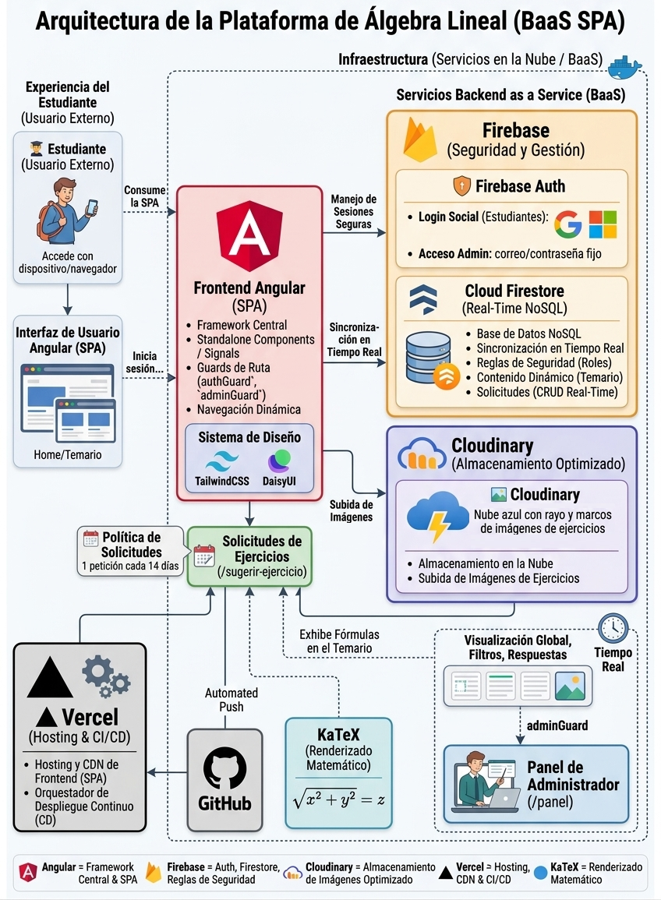
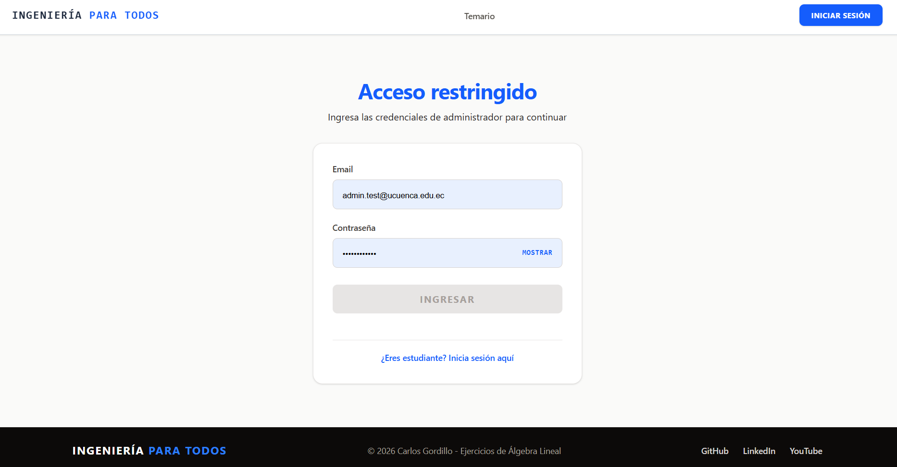
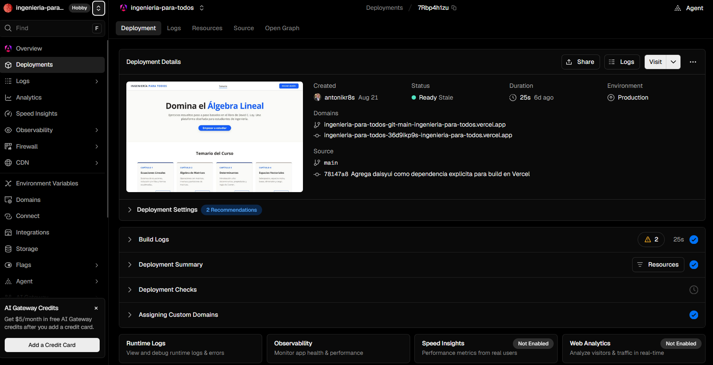

# Plataforma de Álgebra Lineal

## Aplicación Web Educativa con Angular, Firebase y TailwindCSS para la Gestión de Ejercicios

🔗 **Demo en producción:** [ingenieria-para-todos.vercel.app](https://ingenieria-para-todos.vercel.app)


<div align="center">
  
  
  
</div>

---

## Proyecto Final

### Autor

**Carlos Antonio Gordillo Tenemaza**
* 📧 Correo: [antoniogordillo1808@gmail.com](mailto:antoniogordillo1808@gmail.com)
* 💻 GitHub: [antonikr8s](https://github.com/antonikr8s)
* 💼 LinkedIn: [Carlos Antonio Gordillo Tenemaza](https://linkedin.com/in/carlos-antonio-gordillo-tenemaza-828540281/)

---

---

## Descripción

Plataforma educativa donde los estudiantes pueden consultar ejercicios resueltos de álgebra lineal (basados en el libro de David C. Lay), sugerir nuevos ejercicios con fotografía adjunta, y hacer seguimiento a sus solicitudes. Un administrador cuenta con un panel exclusivo para revisar y responder dichas solicitudes.

---

## Stack Tecnológico

| Tecnología | Rol en el Proyecto |
| --- | --- |
| **Angular** | Framework Frontend (Standalone Components, Signals, Enrutamiento dinámico). |
| **TailwindCSS & DaisyUI** | Diseño de interfaces, utilidades CSS y componentes preconstruidos. |
| **Firebase Auth** | Acceso con Google, Microsoft o correo y contraseña. Registro público con verificación del correo. |
| **Firebase Firestore** | Base de datos NoSQL para solicitudes de ejercicios, contenido de capítulos y datos de la plataforma, con reglas de seguridad y notificaciones en tiempo real. |
| **Cloudinary** | Almacenamiento en la nube (unsigned upload) para las fotografías de los ejercicios sugeridos por los estudiantes y las respuestas del administrador. |
| **KaTeX** | Renderizado de fórmulas y ecuaciones matemáticas dentro del contenido de los capítulos. |
| **Vercel** | Hosting y despliegue continuo del frontend, con integración directa a GitHub (despliegue automático en cada `push` a `main`). |
---

## Características Implementadas

### Interfaz de Usuario (UI/UX)
* Maquetación completa con TailwindCSS y DaisyUI.
* Layout principal con Header y Footer personalizados.
* Navegación dinámica indicando la ruta activa (`routerLinkActive`).
* Menú responsive con hamburguesa para dispositivos móviles.

### Autenticación y Seguridad
* Inicio de sesión con Google, Microsoft o correo y contraseña mediante Firebase Auth.
* Acceso interno de administrador (`/internal-login`) mediante correo y contraseña, sin enlaces públicos visibles hacia esa ruta.
* Registro público (`/registro`) con verificación de correo electrónico.
* Guards de ruta: `authGuard` (usuarios autenticados y, para contraseña, correo verificado), `guestGuard` (visitantes) y `adminGuard` (cuenta administradora verificada).
* Reglas de seguridad de Firestore: cada estudiante solo accede a sus propias solicitudes; los administradores acceden a todas y son los únicos que pueden responderlas.

### Temario y Contenido de Capítulos (`/capitulo/:id`)
* Contenido de cada capítulo (subtemas, ejemplos, enlace a video y PDF de ejercicios propuestos) gestionado dinámicamente desde Firestore.
* Tabla de contenido interactiva con navegación tipo scroll suave hacia cada subtema.
* Renderizado de fórmulas y ecuaciones matemáticas mediante KaTeX.
* Recursos descargables (diapositivas resumen del curso) enlazados desde el Home.

### Módulo de Sugerencias (`/sugerir-ejercicio`)
* Formulario de solicitud (Nombre, Correo, Capítulo, Detalles, Foto).
* Fotografía opcional, con validación de formato (JPG/PNG) y tamaño máximo cuando se adjunta.
* Subida de imágenes a Cloudinary (unsigned upload preset).
* Política de solicitudes: 1 petición cada 14 días por estudiante, con fecha y hora exactas de disponibilidad.

### Seguimiento de Solicitudes (`/mis-solicitudes`)
* Vista del estudiante con el historial de sus propias solicitudes, estado (Pendiente/Respondida) y respuesta del administrador (incluyendo imagen de resolución, si se adjuntó).
* Las solicitudes respondidas más recientemente se muestran primero, actualizándose el orden conforme se van resolviendo.
* Notificaciones en tiempo real cuando una solicitud es respondida.

### Panel de Administrador (`/panel`)
* Vista exclusiva (protegida con `adminGuard`) con el listado de todas las solicitudes.
* Filtros por estado (Todas / Pendiente / Respondida).
* Respuesta directa a cada solicitud, con texto y fotografía obligatoria de la resolución, actualizando su estado al instante.
* Notificaciones en tiempo real de nuevas solicitudes pendientes.
* Acceso administrativo limitado a la cuenta configurada en las reglas de Firestore.

---

## Despliegue en Producción

El proyecto está desplegado en **Vercel**, con integración continua desde GitHub: cada `push` a la rama `main` dispara automáticamente un nuevo build y despliegue.

### Configuración del proyecto en Vercel

* **Framework Preset:** Angular
* **Output Directory:** `dist/ingenieria-para-todos/browser` (ruta específica del builder `@angular/build:application` usado por Angular 21; Vercel no la detecta automáticamente y debe configurarse manualmente).
* **Install Command:** `npm install --legacy-peer-deps` (necesario por el conflicto de peer dependency entre Angular 21 y `@angular/fire@20`, que aún no declara soporte oficial para Angular 21).
* **Node.js Version:** 24.x

### Dominios autorizados en Firebase

Para que la autenticación (Google/Microsoft) funcione en producción, el dominio de Vercel (`ingenieria-para-todos.vercel.app`) debe agregarse manualmente en **Firebase Console → Authentication → Settings → Authorized domains**. Sin este paso, el login falla con el error `auth/unauthorized-domain`.

### Notas del proceso de despliegue

Durante la configuración inicial se resolvieron varios problemas comunes al desplegar un proyecto Angular 21 + Firebase en Vercel:
* Conflicto de peer dependencies entre Angular 21 y `@angular/fire` → resuelto con `--legacy-peer-deps`.
* Dependencias de Tailwind (`@tailwindcss/postcss`) y DaisyUI (`daisyui`) no declaradas explícitamente en `package.json` (quedaban instaladas solo de forma transitiva en el entorno local) → causaban error `MODULE_NOT_FOUND` en Vercel; se corrigió agregándolas como dependencias directas.
* Límite de tamaño de bundle (`budgets` en `angular.json`) ajustado de 500kB/1MB a 1MB/2MB para reflejar el tamaño real del proyecto con Firebase, KaTeX y DaisyUI incluidos.

---

## Requisitos y Configuración Local

El proyecto está optimizado para ejecutarse en entornos locales bajo **Windows**.

### Requisitos previos

* **Node.js** (Versión LTS recomendada)
* **Angular CLI** (`npm install -g @angular/cli`)
* **Proyecto configurado en Firebase** (Auth + Firestore), con Google y Microsoft habilitados como proveedores de acceso.
* **Cuenta de Cloudinary** con un upload preset de tipo *unsigned*.

### Instalación

1. Clonar el repositorio:

```bash
git clone https://github.com/antonikr8s/ingenieria-para-todos
cd ingenieria-para-todos
```

2. Instalar dependencias:

> **Nota:** por un conflicto de peer dependencies entre Angular 21 y `@angular/fire`, la instalación requiere la bandera `--legacy-peer-deps`.

```bash
npm install --legacy-peer-deps
```

3. Configurar Firebase y Cloudinary:
   * Completar las credenciales del proyecto de Firebase en `src/app/app.config.ts`.
   * Completar `CLOUD_NAME` y `UPLOAD_PRESET` en `src/app/core/services/cloudinary/cloudinary.service.ts`.

4. Ejecutar el servidor local:

```bash
ng serve
```

El proyecto estará disponible en `http://localhost:4200/`.

### Comprobación local del acceso

Con `npm start`, visita estas rutas en una ventana privada y comprueba el resultado:

1. `/login` muestra correo y contraseña, Google, Microsoft y el enlace «Crear cuenta».
2. `/registro` muestra los requisitos de contraseña. Un formulario incompleto indica qué falta.
3. Después de registrar una dirección que puedas recibir, `/verificar-correo` muestra esa dirección, el contador de reenvío y el botón «Ya verifiqué mi correo».
4. Antes de verificar, `/sugerir-ejercicio` y `/mis-solicitudes` deben enviarte a `/verificar-correo`. Después de verificar, deben abrirse.
5. «Olvidaste tu contraseña» abre el cuadro de recuperación y conserva el correo escrito en `/login`. Solicita el enlace solo con una cuenta de correo propia.
6. `/internal-signup` ya no presenta el formulario anterior. `/panel` debe permitir acceso únicamente a la cuenta administradora.

El correo de Firebase que hoy se envía abre su controlador predeterminado. Las comprobaciones de Firestore deben repetirse cuando se publiquen las reglas del archivo `firestore.rules`.

---

## Arquitectura del Sistema

**Descripción:** El siguiente diagrama ilustra la arquitectura general de la plataforma educativa, diseñada bajo un enfoque moderno de Single Page Application (SPA) apoyado en servicios Cloud.

La solución integra las siguientes tecnologías:

*   **Angular** como framework frontend central para gestionar la interfaz de usuario, el enrutamiento dinámico, los guards de seguridad y el consumo de servicios.
*   **Firebase (Auth & Firestore)** operando como Backend as a Service (BaaS) para la gestión segura de accesos (roles de estudiante y administrador) y la persistencia de datos NoSQL con sincronización en tiempo real.
*   **Cloudinary** para el almacenamiento optimizado y en la nube de las fotografías (mediante *unsigned uploads*).
*   **TailwindCSS & DaisyUI** conformando el sistema de diseño visual, garantizando una interfaz completamente responsiva.
*   **Vercel** como infraestructura de hosting, CDN y orquestador del Despliegue Continuo (CD) automatizado desde el repositorio en GitHub.




## Capturas de Pantalla

### Home (Vista Principal)
**Descripción:** Vista principal de la plataforma educativa centrada en el aprendizaje de Álgebra Lineal. Presenta el objetivo del sitio y el temario general organizado en cuatro capítulos principales.


### Temario
**Descripción:** Despliegue detallado del contenido de estudio. El usuario puede explorar los subtemas de cualquiera de los capítulos presentados en el inicio y consultar ejemplos prácticos con formato matemático.


### Iniciar Sesión
**Descripción:** Pantalla de autenticación con correo y contraseña, Google y Microsoft. Incluye acceso al registro y a la recuperación de contraseña.


### Vista de Usuario Autenticado
**Descripción:** Interfaz principal tras iniciar sesión. La barra de navegación se actualiza para mostrar el correo del estudiante y habilita el acceso a herramientas exclusivas: "Sugerir Ejercicio" y "Mis Solicitudes".


### Sugerir Ejercicio
**Descripción:** Formulario interactivo para solicitar la resolución de problemas específicos. El usuario debe clasificar el ejercicio por capítulo (o elegir "No estoy seguro") y adjuntar obligatoriamente una imagen del problema para enviar la petición.


### Límite de Solicitudes
**Descripción:** Sistema de control de flujo de trabajo. Tras enviar una petición, se establece un periodo de espera de 14 días por usuario. La interfaz proporciona retroalimentación exacta indicando la fecha y hora en la que se habilitará una nueva solicitud.


### Mis Solicitudes
**Descripción:** Historial de estado para el estudiante. Las peticiones ya resueltas se destacan al inicio. Integra un sistema de notificaciones visuales (badge rojo numerado) en el menú de navegación que alerta inmediatamente cuando el tutor ha respondido un ejercicio.


### Dashboard (Panel de Administrador)
**Descripción:** Entorno de gestión exclusivo para el tutor. Permite visualizar las métricas generales y filtrar las solicitudes (Todas, Pendientes, Respondidas). Incluye alertas visuales en la navegación para mantener al administrador al tanto de los ejercicios que aún requieren respuesta.


### Acceso Interno de Administrador (`/internal-login`)
**Descripción:** Ruta heredada de acceso por correo y contraseña. El registro de estudiantes se realiza ahora en `/registro` y requiere verificación del correo.

Una vez autenticado, la barra de navegación muestra **"Dashboard Tutor"** al administrador.


### Registro de estudiantes (`/registro`)
**Descripción:** Formulario público de registro. Los estudiantes deben verificar su correo antes de utilizar las funciones que requieren una cuenta.

### Verificación y recuperación
Tras el registro, `/verificar-correo` muestra el correo de destino, permite comprobar la verificación y ofrece el reenvío tras un contador de 60 segundos. «Olvidaste tu contraseña» abre un formulario de recuperación en `/login`. La página `/auth/action` puede recibir un código de Firebase y pedir una contraseña nueva con confirmación. Los correos actuales siguen abriendo el controlador de Firebase mientras la configuración de plantillas y URL de acción del proyecto esté restringida.

### Despliegue en Producción (Vercel)
**Descripción:** Panel de detalles de Vercel que evidencia el despliegue exitoso y estable de la aplicación en el entorno de producción. Muestra la integración continua (CI/CD) automatizada desde la rama `main` de GitHub, los dominios configurados y una previsualización en vivo de la interfaz.


## Próximos Pasos (En Desarrollo)

### Estado del registro y la verificación

* Registro público y acceso con correo, Google y Microsoft implementados localmente. La ruta duplicada `/internal-signup` fue retirada.
* Reglas de Firestore preparadas en `firestore.rules`. Se publican por separado del despliegue de Vercel.
* `npm run build` completó correctamente. El bundle inicial supera el presupuesto configurado por unos 232 kB.
* `npm test -- --watch=false` todavía falla en las cinco pruebas antiguas por configuración incompleta de Router y Firebase en `TestBed`. La prueba de Home ya importa el nombre actual del componente.
* Pendiente comprobar con cuentas reales el registro, correo de verificación, reenvío, login social, recuperación, permisos de estudiante y panel. La página propia de cambio de contraseña depende de que Firebase permita cambiar la URL de acción o de implementar un envío de correo propio.

### Capturas por renovar

Las imágenes actuales de inicio de sesión y acceso interno representan el flujo anterior. Al terminar las pruebas locales, conviene reemplazar `assets/02-iniciar-sesion.png` y `assets/09-Acceso-interno.png` y añadir capturas de `/registro`, `/verificar-correo` y el cuadro «Recuperar contraseña». `assets/10-creacion-cuentas.png` corresponde a la ruta retirada y ya no debe presentarse como funcionalidad vigente. No incluyas direcciones personales, contraseñas ni enlaces de un solo uso en las capturas.

### Contenido y recursos

* Carga completa del contenido de los 4 capítulos del libro (actualmente en pruebas con datos parciales en Firestore).
* Grabación de los videos explicativos por subtema.
* Validación de tamaño de archivo también del lado del servidor (Cloudinary).
* Optimización del tamaño del bundle inicial para acercarse al presupuesto de rendimiento recomendado por Angular.
