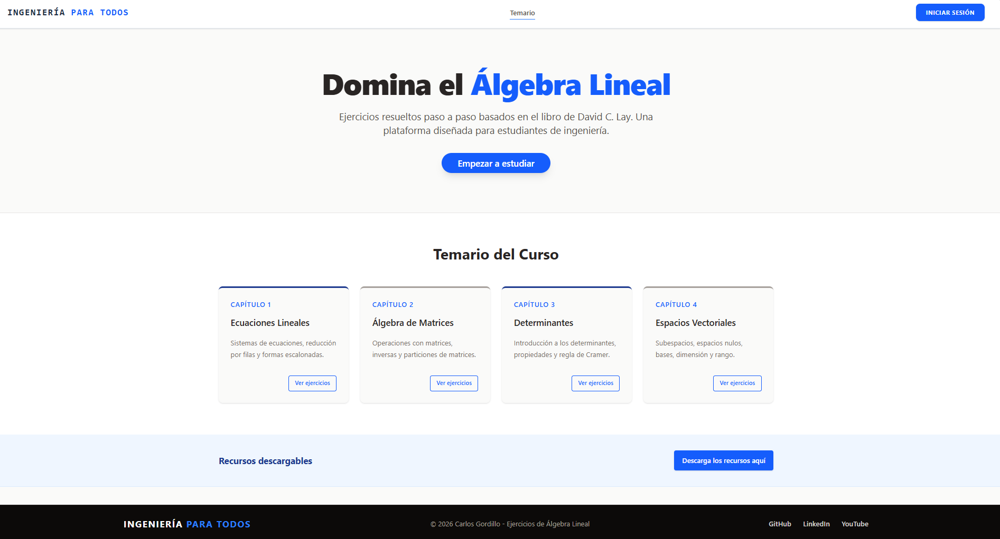
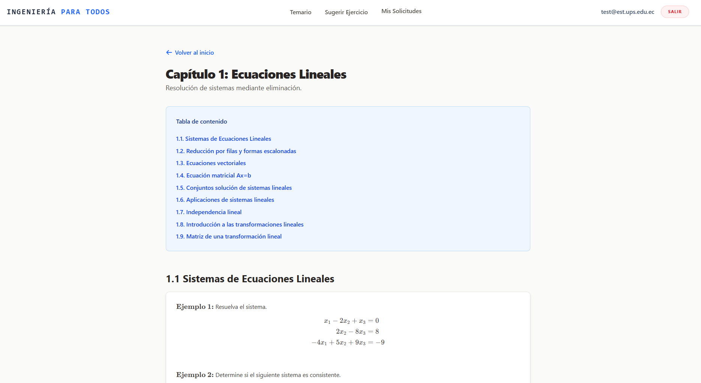
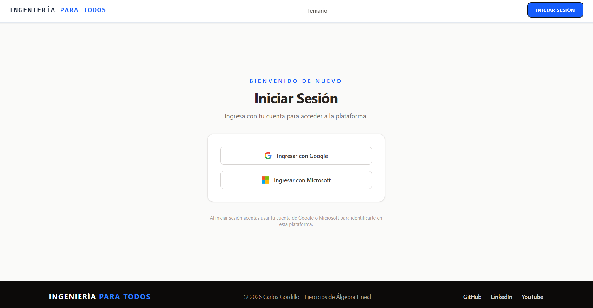
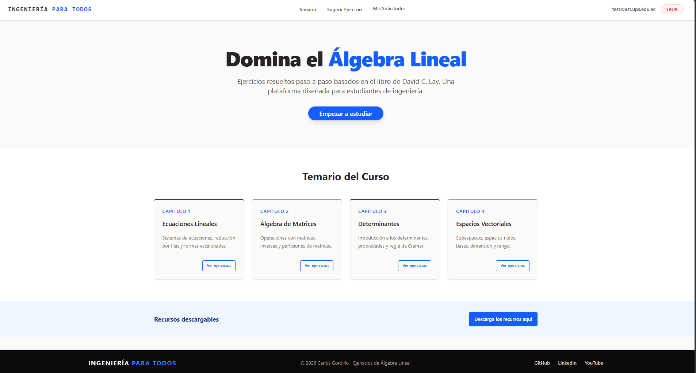
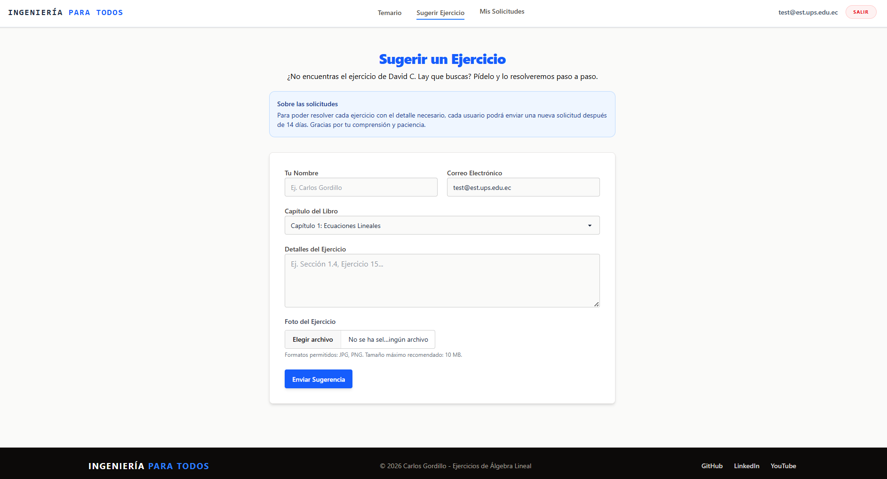
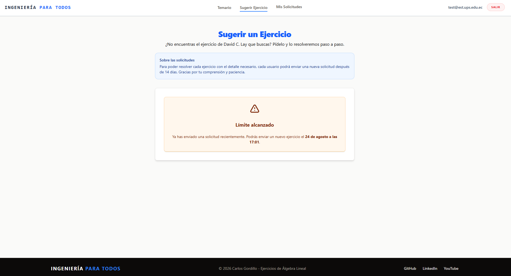
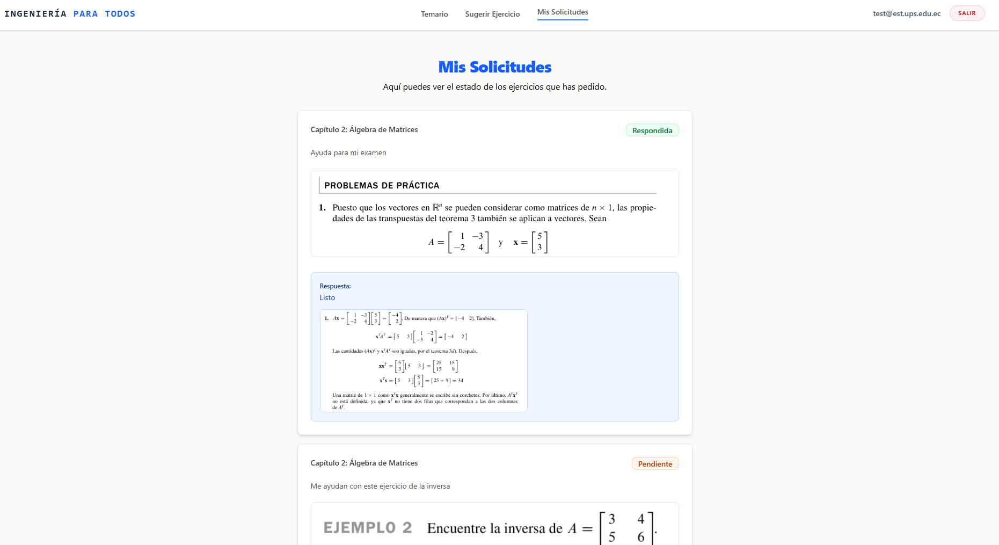
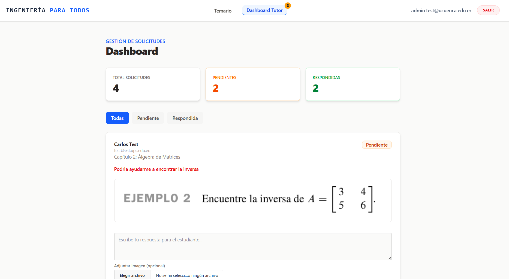

# Plataforma de Álgebra Lineal

## Aplicación Web Educativa con Angular, Firebase y TailwindCSS para la Gestión de Ejercicios


<div align="center">
  
  
  
</div>

---

## Proyecto Final

### Autor

**Carlos Antonio Gordillo Tenemaza**
* 📧 Correo: [antoniogordillo1808@gmail.com](mailto:antoniogordillo1808@gmail.com)
* 💻 GitHub: [antonikr8s](https://github.com/antonikr8s)
* 💼 LinkedIn: [Carlos Antonio Gordillo Tenemaza](https://linkedin.com/in/carlos-antonio-gordillo-tenemaza-828540281/)

---

---

## Descripción

Plataforma educativa donde los estudiantes pueden consultar ejercicios resueltos de álgebra lineal (basados en el libro de David C. Lay), sugerir nuevos ejercicios con fotografía adjunta, y hacer seguimiento a sus solicitudes. Un administrador cuenta con un panel exclusivo para revisar y responder dichas solicitudes.

---

## Stack Tecnológico

| Tecnología | Rol en el Proyecto |
| --- | --- |
| **Angular** | Framework Frontend (Standalone Components, Signals, Enrutamiento dinámico). |
| **TailwindCSS & DaisyUI** | Diseño de interfaces, utilidades CSS y componentes preconstruidos. |
| **Firebase Auth** | Gestión de usuarios mediante autenticación social (Google y Microsoft) para estudiantes. Acceso interno con correo/contraseña restringido al administrador, mediante rutas ocultas no enlazadas públicamente. |
| **Firebase Firestore** | Base de datos NoSQL para solicitudes de ejercicios, contenido de capítulos y datos de la plataforma, con reglas de seguridad y notificaciones en tiempo real. |
| **Cloudinary** | Almacenamiento en la nube (unsigned upload) para las fotografías de los ejercicios sugeridos por los estudiantes y las respuestas del administrador. |
| **KaTeX** | Renderizado de fórmulas y ecuaciones matemáticas dentro del contenido de los capítulos. |

---

## Características Implementadas

### Interfaz de Usuario (UI/UX)
* Maquetación completa con TailwindCSS y DaisyUI.
* Layout principal con Header y Footer personalizados.
* Navegación dinámica indicando la ruta activa (`routerLinkActive`).
* Menú responsive con hamburguesa para dispositivos móviles.

### Autenticación y Seguridad
* Inicio de sesión para estudiantes mediante cuentas sociales: Google y Microsoft (Firebase Auth), evitando el registro con credenciales falsas o correos inexistentes.
* Acceso interno de administrador (`/internal-login`) mediante correo y contraseña, sin enlaces públicos visibles hacia esa ruta.
* Creación de cuentas de prueba o cuentas adicionales de administrador (`/internal-signup`), disponible únicamente para administradores ya autenticados.
* Guards de ruta: `authGuard` (usuarios logueados), `guestGuard` (usuarios no logueados) y `adminGuard` (solo administradores, definidos por lista de correos autorizados).
* Reglas de seguridad de Firestore: cada estudiante solo accede a sus propias solicitudes; los administradores acceden a todas y son los únicos que pueden responderlas.

### Temario y Contenido de Capítulos (`/capitulo/:id`)
* Contenido de cada capítulo (subtemas, ejemplos, enlace a video y PDF de ejercicios propuestos) gestionado dinámicamente desde Firestore.
* Tabla de contenido interactiva con navegación tipo scroll suave hacia cada subtema.
* Renderizado de fórmulas y ecuaciones matemáticas mediante KaTeX.
* Recursos descargables (diapositivas resumen del curso) enlazados desde el Home.

### Módulo de Sugerencias (`/sugerir-ejercicio`)
* Formulario de solicitud (Nombre, Correo, Capítulo, Detalles, Foto).
* Fotografía del ejercicio obligatoria, con validación de formato (JPG/PNG) y tamaño máximo.
* Subida de imágenes a Cloudinary (unsigned upload preset).
* Política de solicitudes: 1 petición cada 14 días por estudiante, con fecha y hora exactas de disponibilidad.

### Seguimiento de Solicitudes (`/mis-solicitudes`)
* Vista del estudiante con el historial de sus propias solicitudes, estado (Pendiente/Respondida) y respuesta del administrador (incluyendo imagen de resolución, si se adjuntó).
* Las solicitudes respondidas más recientemente se muestran primero, actualizándose el orden conforme se van resolviendo.
* Notificaciones en tiempo real cuando una solicitud es respondida.

### Panel de Administrador (`/panel`)
* Vista exclusiva (protegida con `adminGuard`) con el listado de todas las solicitudes.
* Filtros por estado (Todas / Pendiente / Respondida).
* Respuesta directa a cada solicitud, con texto y fotografía obligatoria de la resolución, actualizando su estado al instante.
* Notificaciones en tiempo real de nuevas solicitudes pendientes.
* Soporte para múltiples administradores mediante lista de correos autorizados.

---

## Requisitos y Configuración Local

El proyecto está optimizado para ejecutarse en entornos locales bajo **Windows**.

### Requisitos previos

* **Node.js** (Versión LTS recomendada)
* **Angular CLI** (`npm install -g @angular/cli`)
* **Proyecto configurado en Firebase** (Auth + Firestore), con Google y Microsoft habilitados como proveedores de acceso.
* **Cuenta de Cloudinary** con un upload preset de tipo *unsigned*.

### Instalación

1. Clonar el repositorio:

```bash
git clone https://github.com/antonikr8s/ingenieria-para-todos
cd ingenieria-para-todos
```

2. Instalar dependencias:

```bash
npm install
```

3. Configurar Firebase y Cloudinary:
   * Completar las credenciales del proyecto de Firebase en `src/app/app.config.ts`.
   * Completar `CLOUD_NAME` y `UPLOAD_PRESET` en `src/app/core/services/cloudinary/cloudinary.service.ts`.

4. Ejecutar el servidor local:

```bash
ng serve
```

El proyecto estará disponible en `http://localhost:4200/`.

---

## Próximos Pasos (En Desarrollo)

* Carga completa del contenido de los 4 capítulos del libro (actualmente en pruebas con datos parciales en Firestore).
* Despliegue en Firebase Hosting.
* Grabación de los videos explicativos por subtema.
* Validación de tamaño de archivo también del lado del servidor (Cloudinary).

## Capturas de Pantalla

### Home (Vista Principal)
**Descripción:** Vista principal de la plataforma educativa centrada en el aprendizaje de Álgebra Lineal. Presenta el objetivo del sitio y el temario general organizado en cuatro capítulos principales.


### Temario
**Descripción:** Despliegue detallado del contenido de estudio. El usuario puede explorar los subtemas de cualquiera de los capítulos presentados en el inicio y consultar ejemplos prácticos con formato matemático.


### Iniciar Sesión
**Descripción:** **Descripción:** Pantalla de autenticación. Ofrece a los estudiantes un acceso rápido y seguro mediante inicio de sesión con cuentas de Google o Microsoft.



### Vista de Usuario Autenticado
**Descripción:** Interfaz principal tras iniciar sesión. La barra de navegación se actualiza para mostrar el correo del estudiante y habilita el acceso a herramientas exclusivas: "Sugerir Ejercicio" y "Mis Solicitudes".


### Sugerir Ejercicio
**Descripción:** Formulario interactivo para solicitar la resolución de problemas específicos. El usuario debe clasificar el ejercicio por capítulo (o elegir "No estoy seguro") y adjuntar obligatoriamente una imagen del problema para enviar la petición.


### Límite de Solicitudes
**Descripción:** Sistema de control de flujo de trabajo. Tras enviar una petición, se establece un periodo de espera de 14 días por usuario. La interfaz proporciona retroalimentación exacta indicando la fecha y hora en la que se habilitará una nueva solicitud.


### Mis Solicitudes
**Descripción:** Historial de estado para el estudiante. Las peticiones ya resueltas se destacan al inicio. Integra un sistema de notificaciones visuales (badge rojo numerado) en el menú de navegación que alerta inmediatamente cuando el tutor ha respondido un ejercicio.


### Dashboard (Panel de Administrador)
**Descripción:** Entorno de gestión exclusivo para el tutor. Permite visualizar las métricas generales y filtrar las solicitudes (Todas, Pendientes, Respondidas). Incluye alertas visuales en la navegación para mantener al administrador al tanto de los ejercicios que aún requieren respuesta.


